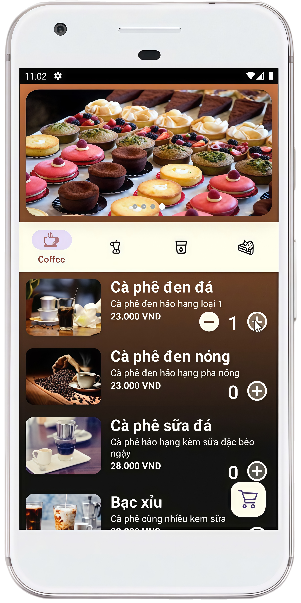
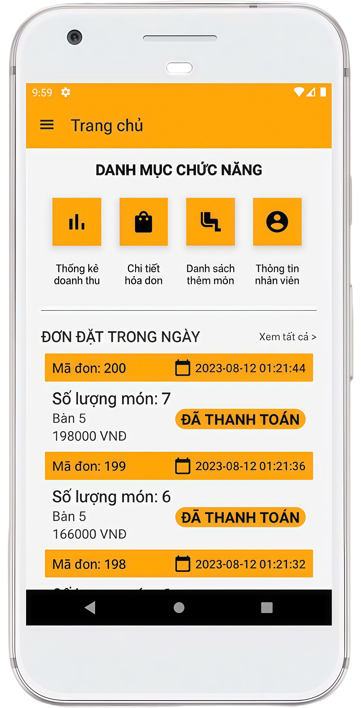
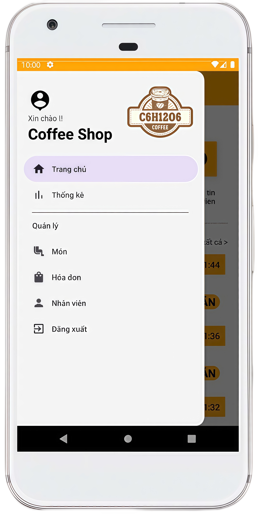

# ☕ Coffee Shop Management App – C6H12O6  

## 📖 Overview  
**C6H12O6 Coffee Shop** is a group project developed to manage café operations efficiently.  
The app allows staff and customers to **place orders, process payments, receive notifications, and track order status in real-time**, helping streamline daily operations and improve customer experience.  

The project is built on **Android (Java)** with **Firebase Cloud Messaging** for notifications and **QR Code scanning** for table management and quick ordering.

---

<p align="center">
  <a href="https://developer.android.com/"></a>
  <a href="https://firebase.google.com/"></a>
  <a href="https://www.mysql.com/"></a>
  <a href="https://www.php.net/"></a>
  <a href="https://github.com/tiendung4411/DuAn1"></a>
</p>

<h4 align="center">
  A mobile app designed to modernize café operations through QR ordering, real-time order tracking, and staff management.<br>
  Built with Android (Java), Firebase, and MySQL.
</h4>

<p align="center">
 <a href="#features">Features</a> •
 <a href="#screenshots">Screenshots</a> •
 <a href="#technologies-used">Technologies Used</a> •
 <a href="#architecture">Architecture</a> •
 <a href="#team--roles">Team & Roles</a> •
 <a href="#future-improvements">Future Improvements</a> •
 <a href="#contact">Contact</a>
</p>

---

## 🚀 Features

- **Order Management** 📦  
  Real-time ordering, updating, and tracking order status.  

- **Push Notifications** 🔔  
  Integrated **Firebase Cloud Messaging** to notify staff and customers instantly when an order is placed or completed.  

- **QR Code Scanning** 📱  
  Identify table location and automate order assignment using **ZXing QR**.  

- **Menu Management** 🍰  
  CRUD operations for drinks, desserts, and food items.  

- **Dashboard for Staff** 🧾  
  View daily orders, manage invoices, and monitor revenue through a visual dashboard.  

---

## 🖼️ Screenshots  

| QR Code Scan | Menu Display | Order Management | Navigation Drawer |
|:-------------:|:-------------:|:----------------:|:----------------:|
|  |  |  |  |

> 📸 *Place screenshots in a `/screenshots` folder inside your repository.*

---

## ⚙️ Technologies Used  

| Category | Technologies |
|-----------|--------------|
| **Mobile Development** | Android (Java) |
| **Backend (Web Server)** | PHP *(pre-provided server)* |
| **Database** | MySQL |
| **UI/UX Design** | Figma, Photoshop *(reference)* |
| **Libraries & Frameworks** | Firebase Cloud Messaging, ZXing QR, Slide |

---

## 🧩 Key Achievements

- Built and deployed a fully functional mobile café management app.

- Successfully integrated real-time notification and QR code ordering.

- Improved teamwork and communication within a 4-member development team.

- Strengthened problem-solving and UI/UX implementation skills. |

---

## 🔮 Future Improvements

- Complete user registration & login module.

- Add sales statistics and promotion management features.

- Optimize CRUD operations and improve performance for large datasets.

- Integrate cloud hosting for backend (e.g., AWS, Render).

---

## 🧰 Tools

- Android Studio – Main IDE for development

- Figma – UI design and prototyping

- Postman – API testing and integration

- GitHub – Version control and collaboration

---

## 🧠 Architecture  

```plaintext
┌────────────────────────────┐
│        Mobile App          │
│  (Android - Java)          │
│                            │
│  • UI Layer (Figma Design) │
│  • Business Logic          │
│  • API Requests (PHP)      │
└──────────────┬─────────────┘
               │
      RESTful APIs (PHP)
               │
┌──────────────▼─────────────┐
│       Database Layer       │
│          MySQL             │
│   • Orders • Menu • Users  │
└────────────────────────────┘

